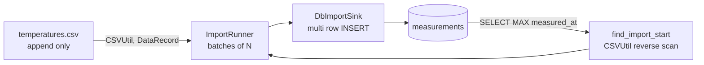

<!-- AI generated by GitHub Copilot (DeepSeek V4 Pro), v1.0 -->
---
name: pi-sensor-database
description: 'Work on the MySQL side of pi_sensor: the measurements table schema, the import_temperatures importer, the Tools::Database/MySqlDB access layer in collectdata/tools, connection settings in ~/.pi_sensor.ini, and SQL for the website. Use when someone asks about the database, table definition, schema change, import_state, INSERT/SELECT queries, mysql_config linking, DBError/exec quirks, or the test instance 192.168.1.200. Trigger words: MySQL, MariaDB, measurements, measured_at, import_state, schema, CREATE TABLE, INSERT, MAX(measured_at), Tools::Database, MySqlDB, DBRow, DBErg, mysql_config, libmariadb, DbImportSink, import_temperatures, database, DST, decimals.'
---

# pi_sensor — database

## What this is

The Pi writes `temperatures.csv`; a server-side importer (`collectdata/import_temperatures`)
copies it into MySQL. The MySQL port is **not** exposed — the importer runs on the
server and connects over `localhost` (or via an SSH tunnel for admin work).

Authoritative sources in the repo:

| File | Contains |
|------|----------|
| `collectdata/src_importer/DbImportSink.cc` | `createTables()`, the `INSERT`/`SELECT MAX(measured_at)` SQL |
| `collectdata/tools/` | `Tools::Database` / `MySqlDB` access layer (copy of lotr_analyzer) |
| `collectdata/config/ConfigDatabase.{h,cc}` | `[database]` config section and defaults |
| `docs/mysql-import-plan.md` | schema rationale, deployment, website queries |

## Schema

```sql
CREATE TABLE measurements (
  id           BIGINT UNSIGNED AUTO_INCREMENT PRIMARY KEY,
  measured_at  DATETIME        NOT NULL,   -- Pi-local time, exactly as in the csv
  temp_inside  DECIMAL(5,2)    NULL,
  hum_inside   DECIMAL(5,2)    NULL,
  temp_outside DECIMAL(5,2)    NULL,
  hum_outside  DECIMAL(5,2)    NULL,
  KEY idx_measured_at (measured_at)
) ENGINE=InnoDB DEFAULT CHARSET=utf8mb4;
```

Rules that must not be broken:

- **No `UNIQUE(measured_at)`.** Timestamps are local wall-clock time; when DST ends
  the same time occurs twice. Exactly-once import is achieved by the importer
  (see below), not by a constraint.
- `measured_at` is written as `DataRecord::getRawDateTimeStr()` (`"YYYY-MM-DD HH:MM:SS"`
  straight from the CSV). Never round-trip it through `time_t`/`mktime` — that
  shifts every summer value by one hour.
- `DECIMAL(5,2)` = max ±999.99, formatted as `%.2f`.
- Deliberately **no FK**, no extra column for humidity units etc.

`import_state (name, byte_offset, file_size, mtime, updated_at)` is **obsolete**
(an earlier version stored the read offset there). It can be dropped:

```sql
DROP TABLE IF EXISTS import_state;
```

## Data flow



## The importer's contract with the DB

1. `SELECT MAX(measured_at) FROM <table>` → newest stored record (`""` when the
   table is empty or missing).
2. `find_import_start()` searches the CSV backwards for that record
   (`CSVUtil::rbegin()`), resumes after it.
3. Per batch: `BEGIN` → one `INSERT ... VALUES (...),(...)...` → `COMMIT`.
4. Therefore: crashes are harmless, a re-run picks up at the newest committed row.
   Never wrap the whole import in one transaction — that would make the resume
   point useless.

Table name: `-t/--table`, `[import] table`, default `measurements`.
Batch size: `-b/--batch`, `[import] batch`, default `500`.
`--create-tables` runs `CREATE TABLE IF NOT EXISTS` (only `measurements`).

## Access layer (`collectdata/tools/`, `Tools::Database`)

```cpp
Database db( host, user, password, dbname, Database::DB_MYSQL );
if( !db ) { std::cerr << db.get_error(); }

auto erg = db.select( "SELECT ...", false );     // result rows
db.exec( "INSERT ..." );                          // no result set
db.commit(); db.rollback();
```

`DBRow` / `DBRowList` are `{names, values}` vectors of strings; `DBTypeInt`,
`DBTypeDouble`, `DBTypeVarChar`, `DBTypeDateTime`, `DBBindType` (in `dbi.h`) map
columns to typed members. The importer uses plain strings, not the bind types.

Pitfalls — all of them bit us already:

- **`exec()` reports failure for INSERT/UPDATE/COMMIT.** `MySqlDB::select()` uses
  `mysql_store_result()`, which is `NULL` for statements without a result set, so
  the returned `DBErg` is `success == false` even on success. Check
  `db.get_error().empty()` instead (see `DbImportSink::exec()`).
- The constructor runs `set AUTOCOMMIT=0`; **every write needs `COMMIT`**.
- `mysql_config --libs` (`$(MYSQL_LIBS)`) belongs in `LDADD`, not `LDFLAGS` —
  with `--as-needed` (Debian/container builds) the library is dropped and the
  link fails with undefined `mysql_*`.
- The DB code is compiled only into `tools/libtoolsdb.a` (`-DTOOLS_USE_DB
  -DTOOLS_USE_MYSQL`, see `tools_config.h`); the GUI and `libcore.a` stay DB-free.
- Quoting is manual (`DbImportSink::quote()` escapes `'` and `\`) — no prepared
  statements.

## Connection settings

`~/.pi_sensor.ini` (or `-c <file>`), section `[database]` of `Configfile2`:

```ini
[database]
host = localhost
username = pi_sensor_import
password = ********          ; else $PI_SENSOR_DB_PASSWORD
instance = pi_sensor         ; database name
retry_db_timeout = 60

[import]
csv = /srv/pi_sensor/staging/temperatures.csv
table = measurements
batch = 500
```

Create a dedicated MySQL user with only `SELECT, INSERT` on `measurements`.

Test instance: `192.168.1.200`, user/db `bleihuetten` (reachable from inside the
network, not publicly). Use `-t measurements_test` + `--create-tables` for
experiments instead of touching `measurements`.

## Useful SQL

```sql
-- status
SELECT COUNT(*) AS rows_total, MIN(measured_at) AS oldest, MAX(measured_at) AS newest
FROM measurements;

-- per day min/max/avg (website graphs)
SELECT DATE(measured_at) AS d,
       MIN(temp_outside) AS t_min, MAX(temp_outside) AS t_max,
       AVG(temp_outside) AS t_avg, AVG(hum_outside) AS h_avg
FROM measurements
GROUP BY d ORDER BY d;

-- downsampled last 24 h (5 min buckets)
SELECT DATE_FORMAT(measured_at, '%Y-%m-%d %H:00') AS hour,
       AVG(temp_outside), AVG(hum_outside)
FROM measurements
WHERE measured_at >= NOW() - INTERVAL 24 HOUR
GROUP BY hour ORDER BY hour;

-- gaps (Pi was off)
SELECT m.measured_at, TIMESTAMPDIFF(MINUTE, m.measured_at, n.measured_at) AS gap_min
FROM measurements m
JOIN measurements n ON n.id = (SELECT MIN(id) FROM measurements WHERE id > m.id)
WHERE TIMESTAMPDIFF(MINUTE, m.measured_at, n.measured_at) > 15
ORDER BY gap_min DESC;
```

Always keep `measured_at` in the `WHERE` so `idx_measured_at` is used.

## Checklist for schema changes

1. Change `DbImportSink::createTables()` **and** `docs/mysql-import-plan.md`.
2. Update the `INSERT` column list in `DbImportSink::insertRows()`.
3. Keep `id` + `idx_measured_at`; the resume logic depends on `MAX(measured_at)`.
4. Re-run `./import_temperatures -t measurements_test --create-tables -f <csv>`
   twice (second run must report `records: 0`).
5. `make check` (the resume tests need no database).
