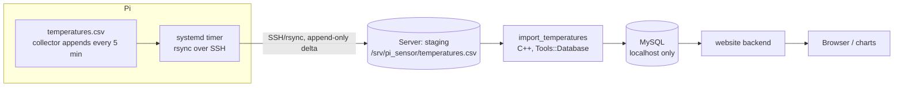

<!-- AI generated by GitHub Copilot (DeepSeek V4 Pro), v1.0 -->
# Plan: export `temperatures.csv` to MySQL and serve it on the website

## Goal

The Raspberry Pi appends one CSV line every 5 minutes to `temperatures.csv`.
That data must end up in **MySQL on the web server** (whose MySQL port is **not
exposed**), and later a **website** displays it.

Decisions taken:

- **Transfer:** `rsync` over SSH (Pi pushes; append-only delta). No MySQL access
  from the Pi.
- **Importer:** runs **on the server**, modelled on the `lotr_analyzer` database
  interface (`Tools::Database` / `Tools::MySqlDB`).
- **lotr_analyzer** will be added to this project (as a submodule) and provides
  the shared database/config/analyzer infrastructure.

## Architecture



Because MySQL is not exposed, the importer must run on the server and use
`localhost`. The Pi only has an SSH key that can write into the staging
directory.

## Data format

CSV, semicolon separated, decimal point, no header:

```
YYYY-MM-DD;HH:MM:SS;temp_inside;hum_inside;temp_outside;hum_outside
2021-02-28;15:45:26;13.40;46.30;15.80;40.80
```

One record per 5 minutes. Times are **Pi-local** (no timezone in the file).

## 1. Transfer: rsync over SSH (Pi → server)

The file is append-only, so rsync transfers only the delta.

Pi, `etc/system.d/pi_sensor_upload.service`:

```ini
[Unit]
Description=Upload temperatures.csv to the web server

[Service]
Type=oneshot
ExecStart=/usr/bin/rsync -a --append-verify --compress \
    /home/pi/pi_sensor/temperatures.csv \
    pi-upload@server:/srv/pi_sensor/staging/
```

Pi, `etc/system.d/pi_sensor_upload.timer`:

```ini
[Unit]
Description=Upload temperatures.csv every 5 minutes

[Timer]
OnBootSec=2min
OnUnitActiveSec=5min
Persistent=true

[Install]
WantedBy=timers.target
```

Server, restrict the key to write-only rsync into one directory
(`rrsync` ships with the rsync package):

```
# ~pi-upload/.ssh/authorized_keys
command="rrsync -wo /srv/pi_sensor/staging",no-agent-forwarding,no-port-forwarding,no-pty ssh-ed25519 AAAA... pi-upload
```

Notes:

- `--append-verify` assumes the destination is a prefix of the source (true for
  an append-only file); it resumes after downtime. If the file is ever rotated /
  replaced, a normal rsync without `--append` reconciles it.
- The staging file may end in a **partial line** while it is being written; the
  importer must only consume complete lines (see below).

## 2. Database schema

```sql
CREATE TABLE measurements (
  id           BIGINT UNSIGNED AUTO_INCREMENT PRIMARY KEY,
  measured_at  DATETIME        NOT NULL,   -- Pi-local time as written in the CSV
  temp_inside  DECIMAL(5,2)    NULL,
  hum_inside   DECIMAL(5,2)    NULL,
  temp_outside DECIMAL(5,2)    NULL,
  hum_outside  DECIMAL(5,2)    NULL,
  KEY idx_measured_at (measured_at)
);

CREATE TABLE import_state (
  name        VARCHAR(64)  NOT NULL PRIMARY KEY,
  byte_offset BIGINT       NOT NULL,
  file_size   BIGINT       NOT NULL,
  mtime       DATETIME     NULL,
  updated_at  DATETIME     NOT NULL
);
```

Do **not** put a `UNIQUE(measured_at)` key: timestamps are local time, and on
DST fall-back the same wall-clock time occurs twice. The byte offset keeps the
import exactly-once, so no unique key is needed.

## 3. Importer (`import_temperatures`)

Repo layout (implemented):

```
collectdata/src/            GUI application only (main.cc, main_window.*, FOX)
collectdata/src_shared/     shared library src_shared/libcore.a
                            (csv_util, DataRecord, filters, plots, logging,
                             BufferedFile, ImportTail/Measurement/ImportRunner)
collectdata/src_importer/   importer: main.cc + DbImportSink.*
collectdata/config/         settings: Configfile2 + sections (libconfig.a)
```

- `src_shared/libcore.a` has **no FOX and no database dependency** and is used by
  the GUI, the importer and the unit tests.
- `import_temperatures` links `config/libconfig.a`, `src_shared/libcore.a`,
  `tools/libtoolsdb.a` (database layer) and `libmariadb` - **no FOX, no X11**
  (verified with `ldd`).
- FOX was moved out of `tools/libtools.a` into `tools/libtheme.a`, so the
  importer can link `libtools.a` without pulling in X11.
- `configure.ac` detects `mysql_config`; without it the importer target is
  skipped (`--without-mysql`).

### Settings: Configfile2 (same infrastructure as lotr_analyzer / Broker)

`collectdata/config/` contains the settings infrastructure copied from
`lotr_analyzer/config/` (`Configfile2`, `Section`, `ValueType`,
`CONFIG_SIMPLE_DECLARE_*` macros). Default config file is `~/.pi_sensor.ini`,
`-c <file>` overrides it. Missing values are appended to the file automatically.

```ini
[global]
LogFile = /home/pi/.pi_sensor.log

[database]
host      = localhost
username  = pi_sensor_import
password  = ********
instance  = pi_sensor
retry_db_timeout = 60

[import]
csv         = /srv/pi_sensor/staging/temperatures.csv
table       = measurements
state_table = import_state
batch       = 500
```

Command line options override the config file: `-H/-u/-p/-D`, `-t/--table`,
`-s/--state-table`, `-n/--state-name`, `-f/--csv`, `-b/--batch`, `--offset`,
`--dry-run`, `--create-tables`, `--reset`, `-v/--verbose`. If `password` is empty
the environment variable `PI_SENSOR_DB_PASSWORD` is used.

### Use the lotr_analyzer database layer

`collectdata/tools/` already contains a copy of the lotr_analyzer DB interface:

- `database.h/.cpp` — `Tools::Database(host, user, passwd, db, DB_MYSQL)`, with
  `exec()`, `select()`, `insert(table, DBRow)`, `insert(table, DBRowList)`
  (bulk), `update()`, `commit()`, `rollback()`.
- `dbi.h/.cpp` — `DBRow`, `DBRowList`, `DBErg`, `DBBindType`, typed columns.
- `mysql_db.h/.cpp` — `Tools::MySqlDB : DB` (the MySQL implementation).
- `db.h/.cpp` — `DB` base + `DBErg`/`DBRowList` types.

These are currently **not** compiled (`libtools.a` has only
`arg/debug/pairs/theme/thread`), and are gated in `tools_config.h` by
`TOOLS_USE_DB` / `TOOLS_USE_MYSQL`. Enable them for the importer target.

Config file (settings infrastructure `Configfile2`, copied from lotr_analyzer),
e.g. `/etc/pi_sensor/import.ini`: see section 3 for the exact keys.

DB credentials stay on the server (never on the Pi). Create a dedicated MySQL
user with only `INSERT, UPDATE, SELECT` on `measurements` and `import_state`.

### Import algorithm (byte offset, complete lines only)

1. Read `import_state.byte_offset` for `measurements` (0 on first run).
2. Open the staging CSV and read from that offset. Reuse `BufferedFile`
   (`collectdata/src/BufferedFile.h`) + `CSVUtil`/`DataRecord` for parsing.
3. Consume only **complete** lines: remember the offset just after the last
   `'\n'`; if the tail has no terminating newline, leave the offset at the last
   complete line (the rest arrives next rsync).
4. Parse each line with the existing `CSVUtil` (semicolon split, empty fields
   suppressed) or `DataRecord`.
5. Insert in batches (`Database::insert("measurements", DBRowList)`), inside a
   transaction; `commit()` per batch.
6. Update `import_state.byte_offset` (and `file_size`, `mtime`) in the **same**
   transaction as the last batch, so a crash re-imports at most one batch.
7. Exit 0 on success; on `--dry-run` parse and count but do not write.

`--create-tables` should run the SQL above (analogous to lotr_analyzer's
`create_sql` / `db/create.sql`). For the very first run (≈514k rows) a
`LOAD DATA LOCAL INFILE` pre-load is a useful optimization; afterwards the
incremental insert path takes over.

### lotr_analyzer as a submodule

Add lotr_analyzer to this project (e.g. `git submodule add <url> analyzer` or
under `third_party/`). The importer and the later website backend then share the
same `Tools::Database` abstraction and config/ini handling, instead of
duplicating them. (Until that lands, the copies in `collectdata/tools/` are
used.)

## 4. Website

- Backend reads MySQL (`localhost`); keep DB access server-side.
- Query `measurements` with `measured_at` indexed; for graphs, query a
  **downsampled** result (per 5 min / hour / day) instead of all rows.
- A C++ backend is viable (reuse `Tools::Database`, expose JSON over FastCGI or
  a small HTTP server). PHP/Python + Chart.js is less work if preferred.
- The Pi is never involved at query time.

## 5. Security checklist

- MySQL stays bound to `localhost` / not exposed.
- Pi SSH key: dedicated user + `command="rrsync -wo /srv/pi_sensor/staging"`.
- DB user: minimal privileges; credentials only on the server.
- Staging dir owned by `pi-upload`, importer runs as a separate user with read
  access.
- For ad-hoc admin access use an SSH tunnel (`ssh -L 3306:localhost:3306`), not
  an exposed port.

## 6. Tests (no database required)

Split the importer into a testable core:

- `ImportState` (offset bookkeeping) and a `LineReader` that yields complete
  lines from a `BufferedFile` starting at an offset.
- Unit tests in `src_test/`:
  - offset advances only past the last complete line (partial tail is kept);
  - running the importer twice with the same file is a no-op the second time;
  - a line appended later is picked up exactly once;
  - empty line / empty fields follow `CSVUtil` semantics.
- The DB sink is behind a small interface so tests use an in-memory fake sink;
  a real MySQL integration test can be optional/tagged.

## 7. Implementation steps

1. Pi: add `pi_sensor_upload.{service,timer}` to `etc/system.d/` + the
   restricted SSH key on the server.
2. Server: create `/srv/pi_sensor/staging`, run the `create.sql` schema, create
   the limited MySQL user.
3. Add lotr_analyzer as a submodule (or wire `collectdata/tools/` DB files).
4. `tools_config.h`: the database code is enabled per target in `Makefile.am`
   (`-DTOOLS_USE_DB -DTOOLS_USE_MYSQL` for `libtoolsdb.a` and the importer), so
   the GUI and the shared library stay free of MySQL code.
5. `Makefile.am`: `src_shared/libcore.a` (shared), `config/libconfig.a`
   (settings), `tools/libtoolsdb.a` (database layer), `collectdata` (FOX GUI) and
   `import_temperatures` (`src_importer/main.cc` + `DbImportSink.cc`, links
   `libmariadb` via `mysql_config`).
6. Implement offset + partial-line handling with unit tests (section 6).
7. Server timer: run the importer after each rsync (or every few minutes).
8. Build the website against `measurements`.

## Open questions

- Should the raw Pi-local timestamp stay as-is, or be converted to UTC on import
  (needs a TZ/DST policy)? The current plan stores local time and relies on the
  byte offset for exactly-once import.
- Keep one growing staging file, or rotate the Pi output to daily files (simpler
  per-file import bookkeeping)?
- Final home for lotr_analyzer in this repo (submodule path) and whether the
  website backend reuses its analyzer code.
<!-- End of AI generated by GitHub Copilot (DeepSeek V4 Pro), v1.0 -->
