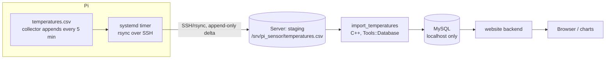

<!-- AI generated by GitHub Copilot (DeepSeek V4 Pro), v1.0 -->
# Plan: export `temperatures.csv` to MySQL and serve it on the website

## Goal

The Raspberry Pi appends one CSV line every 5 minutes to `temperatures.csv`.
That data must end up in **MySQL on the web server** (whose MySQL port is **not
exposed**), and later a **website** displays it.

Decisions taken:

- **Transfer:** `rsync` over SSH (Pi pushes; append-only delta). No MySQL access
  from the Pi.
- **Importer:** runs **on the server**, modelled on the `lotr_analyzer` database
  interface (`Tools::Database` / `Tools::MySqlDB`).
- **lotr_analyzer** will be added to this project (as a submodule) and provides
  the shared database/config/analyzer infrastructure.

## Architecture



Because MySQL is not exposed, the importer must run on the server and use
`localhost`. The Pi only has an SSH key that can write into the staging
directory.

## Data format

CSV, semicolon separated, decimal point, no header:

```
YYYY-MM-DD;HH:MM:SS;temp_inside;hum_inside;temp_outside;hum_outside
2021-02-28;15:45:26;13.40;46.30;15.80;40.80
```

One record per 5 minutes. Times are **Pi-local** (no timezone in the file).

## 1. Transfer: rsync over SSH (Pi → server)

The file is append-only, so rsync transfers only the delta.

Pi, `etc/system.d/pi_sensor_upload.service`:

```ini
[Unit]
Description=Upload temperatures.csv to the web server

[Service]
Type=oneshot
ExecStart=/usr/bin/rsync -a --append-verify --compress \
    /home/pi/pi_sensor/temperatures.csv \
    pi-upload@server:/srv/pi_sensor/staging/
```

Pi, `etc/system.d/pi_sensor_upload.timer`:

```ini
[Unit]
Description=Upload temperatures.csv every 5 minutes

[Timer]
OnBootSec=2min
OnUnitActiveSec=5min
Persistent=true

[Install]
WantedBy=timers.target
```

Server, restrict the key to write-only rsync into one directory
(`rrsync` ships with the rsync package):

```
# ~pi-upload/.ssh/authorized_keys
command="rrsync -wo /srv/pi_sensor/staging",no-agent-forwarding,no-port-forwarding,no-pty ssh-ed25519 AAAA... pi-upload
```

Notes:

- `--append-verify` assumes the destination is a prefix of the source (true for
  an append-only file); it resumes after downtime. If the file is ever rotated /
  replaced, a normal rsync without `--append` reconciles it.
- The staging file may end in a **partial line** while it is being written; the
  importer must only consume complete lines (see below).

## 2. Database schema

```sql
CREATE TABLE measurements (
  id           BIGINT UNSIGNED AUTO_INCREMENT PRIMARY KEY,
  measured_at  DATETIME        NOT NULL,   -- Pi-local time as written in the CSV
  temp_inside  DECIMAL(5,2)    NULL,
  hum_inside   DECIMAL(5,2)    NULL,
  temp_outside DECIMAL(5,2)    NULL,
  hum_outside  DECIMAL(5,2)    NULL,
  UNIQUE KEY uniq_measured_at (measured_at)
);
```

`measured_at` is **UNIQUE**, so the same timestamp can exist only once. The
importer checks per day which timestamps are already stored and skips them;
`INSERT ... ON DUPLICATE KEY UPDATE` makes the write safe even if the check is
raced, and lets `--full` refresh existing rows.

Consequence at the end of DST: the hour that occurs twice has the same
wall-clock times in the CSV. The second record updates the first one (last one
wins) instead of creating a duplicate row.

`--create-tables` also runs `ALTER TABLE ... ADD UNIQUE KEY uniq_measured_at`
(ignoring "Duplicate key name"), so tables created by an older version are
upgraded. If such a table already contains duplicates the `ALTER` fails and the
duplicates have to be removed first.

There is **no `import_state` table** any more (an older version stored the read
offset there; it can be dropped).

## 3. Importer (`import_temperatures`)

Repo layout (implemented):

```
collectdata/src/            GUI application only (main.cc, main_window.*, FOX)
collectdata/src_shared/     shared library src_shared/libcore.a
                            (csv_util, DataRecord, filters, plots, logging,
                             BufferedFile, ImportResume/ImportRunner)
collectdata/src_importer/   importer: main.cc + DbImportSink.*
collectdata/config/         settings: Configfile2 + sections (libconfig.a)
```

- `src_shared/libcore.a` has **no FOX and no database dependency** and is used by
  the GUI, the importer and the unit tests.
- `import_temperatures` links `config/libconfig.a`, `src_shared/libcore.a`,
  `tools/libtoolsdb.a` (database layer) and `libmariadb` - **no FOX, no X11**
  (verified with `ldd`).
- FOX was moved out of `tools/libtools.a` into `tools/libtheme.a`, so the
  importer can link `libtools.a` without pulling in X11.
- `configure.ac` detects `mysql_config`; without it the importer target is
  skipped (`--without-mysql`).

### Settings: Configfile2 (same infrastructure as lotr_analyzer / Broker)

`collectdata/config/` contains the settings infrastructure copied from
`lotr_analyzer/config/` (`Configfile2`, `Section`, `ValueType`,
`CONFIG_SIMPLE_DECLARE_*` macros). Default config file is `~/.pi_sensor.ini`,
`-c <file>` overrides it. Missing values are appended to the file automatically.

```ini
[global]
LogFile = /home/pi/.pi_sensor.log

[database]
host      = localhost
username  = pi_sensor_import
password  = ********
instance  = pi_sensor
retry_db_timeout = 60

[import]
csv         = /srv/pi_sensor/staging/temperatures.csv
table       = measurements
batch       = 500
```

Command line options override the config file: `-H/-u/-p/-D`, `-t/--table`,
`-f/--csv`, `-b/--batch`, `--offset`, `--full`, `--dry-run`, `--create-tables`,
`--no-wait`, `--wait-timeout SECONDS`, `-v/--verbose`, `-d/--debug`. If
`password` is empty the environment variable `PI_SENSOR_DB_PASSWORD` is used.

Path values (`csv`, `lock_file`, `LogFile`) may start with `~/`: the home
directory of the user running the importer is substituted
(`ConfigSectionImport::read()`). A missing or unreadable csv is written to the
log **and** stderr and exits with code 3 - it never silently imports 0 rows.

Logging: the importer starts the async debug logger
(`logInit()` / `LogSession` from `src_shared/logging.h`). Messages go to
`[global] LogFile` (default `~/.pi_sensor.log`, rotated at 10 MB); `-d` mirrors
the same stream to the console. Each run logs the config used, the newest
database record, the chosen start offset and the import result.

### Use the lotr_analyzer database layer

`collectdata/tools/` already contains a copy of the lotr_analyzer DB interface:

- `database.h/.cpp` — `Tools::Database(host, user, passwd, db, DB_MYSQL)`, with
  `exec()`, `select()`, `insert(table, DBRow)`, `insert(table, DBRowList)`
  (bulk), `update()`, `commit()`, `rollback()`.
- `dbi.h/.cpp` — `DBRow`, `DBRowList`, `DBErg`, `DBBindType`, typed columns.
- `mysql_db.h/.cpp` — `Tools::MySqlDB : DB` (the MySQL implementation).
- `db.h/.cpp` — `DB` base + `DBErg`/`DBRowList` types.

These are currently **not** compiled (`libtools.a` has only
`arg/debug/pairs/theme/thread`), and are gated in `tools_config.h` by
`TOOLS_USE_DB` / `TOOLS_USE_MYSQL`. Enable them for the importer target.

Config file (settings infrastructure `Configfile2`, copied from lotr_analyzer),
e.g. `/etc/pi_sensor/import.ini`: see section 3 for the exact keys.

DB credentials stay on the server (never on the Pi). Create a dedicated MySQL
user with only `INSERT, UPDATE, SELECT` on `measurements`.

### Import algorithm (no stored state)

0. Wait until **no other process has the staging csv open**. rsync keeps the
destination file open while it writes (`--append-verify` writes in place), so
the importer would otherwise read a half written transfer. The check scans
`/proc/<pid>/fd` and compares device/inode, so it is independent of the path.
The wait is limited by `[database] retry_db_timeout` (default **60 s**, the same
timeout as for the database; `--wait-timeout N` overrides it, `--no-wait`
disables the check). When the timeout is reached the import is **aborted** with
exit code 5. Only processes of the same user (or root) are visible in `/proc`.

Two more safeguards (`src_shared/FileBusy.h`):

- **Advisory lock against parallel imports**: `flock()` on `[import] lock_file`
  (default `/tmp/pi_sensor_import.lock`). Two importers (cron + systemd timer,
  or two hosts) would serialize on the same rows and can deadlock; the second
  one waits (same 60 s limit) and then aborts with exit code 5. rsync does
  **not** take part in advisory locks, so locking the csv itself would not stop
  it - that is what the `/proc` check above is for.
- **Change detection while reading**: device/inode/size/mtime (including
  nanoseconds) are compared before and after the read. If the file was modified
  in place (inode unchanged, mtime changed or shrunk) the import is aborted with
  exit code 6 and the next run continues - nothing half written is imported. A
  file replaced by `rename()` (rsync without `--inplace`) is a consistent
  snapshot and does not abort.

Exit codes: `0` ok, `2` missing settings, `3` database/file access,
`4` import failed, `5` file still open or another import running (wait timeout),
`6` file changed while reading.
1. `SELECT MAX(measured_at) FROM measurements` - the newest record that is
   already in the database (`db newest`).
2. Open the staging CSV with `CSVUtil` and search **backwards**
   (`CSVUtil::rbegin()` / `rend()`) for the last line whose timestamp is
   `<= db newest`. Record its `getNextLinePos()` as the start offset.
   - best case: that is the last line, one line is read;
   - worst case (nothing matches, e.g. empty database): the file is scanned
     once backwards and then imported once forwards.
3. Import forward from that offset with `CSVUtil::iterator`, one `DataRecord`
   per line (semicolon split, empty fields suppressed, same code path as the
   GUI).
4. The records are buffered **per day** (memory stays at ~288 records, no matter
   how big the file is) and flushed when the date changes:
   - `SELECT measured_at FROM measurements WHERE measured_at >= '<day> 00:00:00'
     AND measured_at < '<day> 00:00:00' + INTERVAL 1 DAY` gives the timestamps
     that already exist;
   - those records are skipped (counted as `skipped`), the rest is inserted in
     `batch` sized `INSERT ... ON DUPLICATE KEY UPDATE` statements, one
     transaction per insert.
5. Consume only **complete** lines: only up to `complete_file_size()`, i.e. the
   last `'\n'`. A record still being written by rsync is left for the next run.
6. A crash is harmless: the next run resumes at the newest committed record.
7. `--dry-run` parses and counts without a database. `--full` starts at offset 0
   and scans the whole file, but still skips everything that is already in the
   database - it only fills gaps. `--offset N` forces a start offset
   (debugging).

`--create-tables` creates `measurements` (`CREATE TABLE IF NOT EXISTS`).
For the very first run (≈514k rows) a `LOAD DATA LOCAL INFILE` pre-load is a
useful optimization; afterwards the incremental insert path takes over.

DST note: the timestamp of a record is taken from the CSV text
(`DataRecord::getRawDateTimeStr()`), not converted through `time_t`. A
`mktime`/`localtime` round trip shifts local wall clock times by an hour while
DST is active.

### lotr_analyzer as a submodule

Add lotr_analyzer to this project (e.g. `git submodule add <url> analyzer` or
under `third_party/`). The importer and the later website backend then share the
same `Tools::Database` abstraction and config/ini handling, instead of
duplicating them. (Until that lands, the copies in `collectdata/tools/` are
used.)

## 4. Website

- Backend reads MySQL (`localhost`); keep DB access server-side.
- Query `measurements` with `measured_at` indexed; for graphs, query a
  **downsampled** result (per 5 min / hour / day) instead of all rows.
- A C++ backend is viable (reuse `Tools::Database`, expose JSON over FastCGI or
  a small HTTP server). PHP/Python + Chart.js is less work if preferred.
- The Pi is never involved at query time.

### Building and running on the server (docker, same host as lotr_analyzer)

`collectdata/` contains the same container layout as `lotr_analyzer`
(debian:trixie):

| directory | purpose |
| --- | --- |
| `build_container/` | g++, automake/autoconf, pkg-config, `libfox-1.6-dev`, `default-libmysqlclient-dev` |
| `run_container/` | runtime for `import_temperatures`: `libmariadb3`, no compiler, no X11 |

```
cd collectdata
git submodule update --init --recursive          # on the host
./build_container/run_container.sh               # reconfigure + build
./build_container/run_container.sh make check
./run_container/run_container.sh                 # run the import
```

The run container mounts the current directory as `/workspace`,
`$PI_SENSOR_STAGING` (default `/srv/pi_sensor`), `~/.pi_sensor.ini` and
`/run/mysqld` (each only if present). It runs with the calling uid/gid, and
`/etc/passwd` is mounted read-only so `~` in the config resolves.

For a server without X11 use `./reconfigure.sh --without-fox`: FOX is optional
since `configure` only builds the GUI when the toolkit is found.

## 5. Security checklist

- MySQL stays bound to `localhost` / not exposed.
- Pi SSH key: dedicated user + `command="rrsync -wo /srv/pi_sensor/staging"`.
- DB user: minimal privileges; credentials only on the server.
- Staging dir owned by `pi-upload`, importer runs as a separate user with read
  access.
- For ad-hoc admin access use an SSH tunnel (`ssh -L 3306:localhost:3306`), not
  an exposed port.

## 6. Tests (no database required)

The resumable core is `find_import_start()` / `complete_file_size()` in
`src_shared/ImportResume.h`; the "newest record in the database" is just a
string, so the tests need no MySQL.

Unit tests in `src_test/test_importresume.cc`:

- empty database -> offset 0 (import everything);
- newest record in the middle of the file -> offset after that line;
- file already fully imported -> offset at end (no records);
- trailing partial line (rsync still writing) is not imported, and the same
timestamp found before it is used;
- identical timestamps (DST fall-back) -> the **last** occurrence wins;
- missing file -> -1.

Unit tests in `src_test/test_importrunner.cc` (in-memory sink):

- one store call per day, so memory is bounded by a day;
- existing timestamps of a day are skipped and counted as `skipped`;
- a full rescan (`--full`, offset 0) skips existing records and only fills gaps;
- batching respects the `batch` size;
- a trailing partial line is not imported.

The DB sink is behind `ImportSink`, so tests / `--dry-run` use an in-memory
sink; a real MySQL integration test can be optional/tagged.

End-to-end check (manual, against a scratch table):

```
./import_temperatures -t measurements_test --create-tables -f test.csv   # 3 records
./import_temperatures -t measurements_test -f test.csv                   # 0 records
```

## 7. Implementation steps

1. Pi: add `pi_sensor_upload.{service,timer}` to `etc/system.d/` + the
   restricted SSH key on the server.
2. Server: create `/srv/pi_sensor/staging`, run the `create.sql` schema, create
   the limited MySQL user.
3. Add lotr_analyzer as a submodule (or wire `collectdata/tools/` DB files).
4. `tools_config.h`: the database code is enabled per target in `Makefile.am`
   (`-DTOOLS_USE_DB -DTOOLS_USE_MYSQL` for `libtoolsdb.a` and the importer), so
   the GUI and the shared library stay free of MySQL code.
5. `Makefile.am`: `src_shared/libcore.a` (shared), `config/libconfig.a`
   (settings), `tools/libtoolsdb.a` (database layer), `collectdata` (FOX GUI) and
   `import_temperatures` (`src_importer/main.cc` + `DbImportSink.cc`, links
   `libmariadb` via `mysql_config`).
6. Resume search (`find_import_start`) + partial-line handling, with unit tests
   (section 6).
7. Server timer: run the importer after each rsync (or every few minutes). The
   importer waits for rsync to close the file, so overlapping runs are safe.
8. Build the website against `measurements`.

## Open questions

- Should the raw Pi-local timestamp stay as-is, or be converted to UTC on import
  (needs a TZ/DST policy)? The current plan stores local time unchanged and
  compares it as text, so DST does not shift values.
- Keep one growing staging file, or rotate the Pi output to daily files (simpler
  per-file import bookkeeping)?
- Final home for lotr_analyzer in this repo (submodule path) and whether the
  website backend reuses its analyzer code.
<!-- End of AI generated by GitHub Copilot (DeepSeek V4 Pro), v1.0 -->
