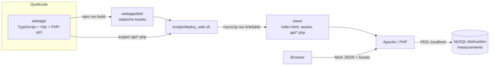

<!-- AI generated by GitHub Copilot (DeepSeek V4 Pro), v1.0 -->
# Plan: Webseite für die Messdaten (`www/`)

## Ziel

Eine Webseite, die die Messdaten aus MySQL anzeigt:

1. **Aktuelle Werte** (letzter Datensatz: innen/außen Temperatur + Luftfeuchte, Zeitstempel)
2. **Min/Max der letzten 24 Stunden** (pro Messwert, zusätzlich Durchschnitt)
3. **Temperaturverlauf der letzten 14 Tage** (Diagramm)
4. **Presets** – vordefinierte Ansichten (Zeiträume + Messreihen) per Knopfdruck wechselbar
5. **Zoom** im Diagramm (Mausrad + Drag)
6. **Dark Mode** (hell/dunkel/auto)

**Neue Randbedingungen:**

- **`www/` enthält nur ausgelieferte Artefakte** – kein TypeScript-Quellcode, kein
  `node_modules`, kein `package.json`. Der Quellcode lebt in `webapp/`, ein
  Deploy-Skript in `scripts/` kopiert die gebauten Daten nach `www/`.
- **Doppelte Datensätze** in `measurements` werden bereinigt und dürfen später
  nicht wieder entstehen (siehe Abschnitt „Datenbank").
- Aus dem ins Repo kopierten Projekt **PIDDojo** werden alle brauchbaren Muster
  übernommen (uPlot-Chart-Wrapper, Theme-System, Vite/TS-Konfiguration).

---

## Ist-Zustand (geprüft)

| Baustein | Status |
|----------|--------|
| Web-Server | Apache 2, `DocumentRoot /var/www/html`, PHP 8.4 als `mod_php` aktiv |
| PHP | 8.4.16, `pdo_mysql` + `mysqli` vorhanden |
| Node/npm | Node **22.23.4**, npm **10.9.9** (User-Installation `~/.local/share/pi-node`) |
| MySQL | MariaDB 11.8 auf `localhost`, DB/User/Passwort: `bleihuetten`/`bleihuetten`/`bleihuetten` |
| Tabelle | `measurements`, **88.576** Zeilen, Zeitraum 2026-05-18 … 2026-11-09 |
| `www/` | aktuell leer |
| `scripts/` | existiert noch nicht, wird angelegt |
| PIDDojo | nach `PIDDojo/` kopiert (upstream `github.com:majorkingleo/PIDDojo`, MIT, Martin Oberzalek) |

Wichtige Eigenheiten:

- **Duplikate:** Die Tabelle wurde offenbar **zweimal vollständig importiert**
  (id 1…44288 und 44289…88576 enthalten dieselben Daten; `id 44288` und
  `id 88576` haben beide `2026-11-09 21:20:24`). Das wird einmalig bereinigt.
- `measurements` hat **keine** `UNIQUE(measured_at)`-Einschränkung (bewusst, wegen
  DST-Rücksprung). „Keine Duplikate" wird deshalb über **Bereinigung + Import-
  Logik** erreicht, nicht über einen Unique-Key (Details unten).
- `measured_at` ist Pi-lokale Wanduhrzeit. In der Testumgebung laufen Pi- und
  Server-Uhr gleich, daher ist `NOW() - INTERVAL …` korrekt.
- Das gesamte Repo liegt unter `/var/www/html` (also im Web-Root). Daher gehören
  DB-Zugangsdaten in eine Datei **außerhalb von `www/`** und Apache muss
  Nicht-`www`-Verzeichnisse ggf. abschirmen (siehe Sicherheit).

---

## Technologie-Entscheidung

**TypeScript + Vite + uPlot im Frontend, PHP als Backend, Deploy per Skript.**

### Soll es TypeScript sein?

**Ja.** Begründung:

- Presets, Chart-Optionen und API-Antworten werden als Typen modelliert
  (`Field`, `Preset`, `SeriesResponse`). Feldnamen-Fehler fallen beim Build auf.
- Dark-Mode- und Zoom-Zustand sind State; Typen machen die Übergaben klar.
- TypeScript/Vite ist in **PIDDojo** bereits erprobt – wir übernehmen dessen
  Konfiguration (strict, `base: './'`, `manualChunks`) und Muster.

TypeScript gilt **nur fürs Frontend**. Das Backend bleibt **PHP**, weil
Apache + `mod_php` bereits laufen und PHP nativ auf `localhost` MySQL erreicht –
ohne einen dauerhaft laufenden Node-Dienst.

### Chart-Bibliothek: uPlot (statt ECharts)

Ursprünglich war Apache ECharts geplant. **Neu: uPlot**, weil PIDDojo bereits
einen sauberen uPlot-Wrapper mitbringt und wir den direkt übernehmen können:

- `uplot` (v1.6.x) ist bereits PIDDojo-Dependency; ~50 KB statt ~1 MB (ECharts).
- **Zoom** ist eingebaut: Mausrad-Zoom + Drag-Zoom/Pan
  (`cursor.drag.setScale`, Zeitachse `time: true`).
- **Dark Mode** über die Farb-Palette des Wrappers (`seriesColors(light)`),
  umschaltbar per `setTheme(light)`.
- **Presets** laden neue Daten und rufen `plot.setData(...)` auf – kein
  Framework-Lock-in.

Für „Min/Max letzte 24 h" und „aktuelle Werte" ist gar kein Chart nötig
(Kacheln/Tabelle), das Diagramm übernimmt uPlot für die Zeitreihe.

---

## Aus PIDDojo übernommene Muster („Skills")

PIDDojo hat **keine** `.github/skills/`-Dateien. Brauchbar sind die bewährten
Projektmuster; sie werden beim Umsetzen übernommen (nicht blind kopiert, sondern
an die Messdaten angepasst):

| PIDDojo-Quelle | Übernahme für die Messdaten-Webseite |
|----------------|--------------------------------------|
| `src/chart.ts` | dünner uPlot-Wrapper: `Chart`-Klasse mit `ResizeObserver`, `setTheme()`, `setData()`, gekapptem Ringpuffer (`MAX_POINTS`) |
| `src/colormaps.ts` (`isLightTheme`, `seriesColors`) | Farbpaletten hell/dunkel, `data-theme`-Auswertung |
| `src/styles.css` (`:root`/`[data-theme='dark']`/`[data-theme='light']`, `color-scheme`) | CSS-Custom-Properties für Dark Mode, `☀`/`☾`-Umschalter |
| `src/main.ts` (Theme-Boot, `localStorage`-Key) | Theme-State: `localStorage`, `matchMedia('(prefers-color-scheme: dark)')`, `data-theme` setzen |
| `src/persistence.ts` | Muster für `localStorage`-Persistenz (Preset-Wahl, Theme) |
| `src/state.ts` / `src/types.ts` | kleine, reine State-Übergänge; alle Typen in **einem** Modul |
| `tsconfig.json` | strict, `moduleResolution: bundler`, `noEmit`, `isolatedModules` |
| `vite.config.ts` | `base: './'`, `manualChunks` für Vendor-Splitting |
| `package.json` (Scripts) | `dev`, `build` = `tsc --noEmit && vite build`, `typecheck`, `preview` |

**Lizenz/Attribution:** Übernommener Code stammt aus PIDDojo (MIT,
Martin Oberzalek). Laut `.github/copilot-instructions.md` bekommt solcher Code
**keinen** „AI generated"-Marker, sondern einen Kommentar mit Originalquelle und
Autor (z. B. `// adapted from PIDDojo src/chart.ts, Martin Oberzalek (MIT)`).

---

## Werkzeuge für TypeScript auf diesem Server

**Was installiert sein muss:**

| Werkzeug | Benötigt | Status |
|----------|----------|--------|
| Node.js | ≥ 20 (LTS) | ✅ vorhanden: **v22.23.4** (`~/.local/share/pi-node/current/bin/node`) |
| npm | ≥ 10 | ✅ vorhanden: **10.9.9** |
| TypeScript | nur projektlokal | kommt als `devDependency` in `webapp/package.json` |
| Vite | nur projektlokal | kommt als `devDependency` in `webapp/package.json` |
| uPlot | nur projektlokal | kommt als `dependency` in `webapp/package.json` |

**Es ist keine globale Installation nötig.** `typescript`, `vite` und `uplot`
werden über `npm install`/`npm ci` in `webapp/node_modules/` installiert und per
`npm run build` aufgerufen (dort steckt der lokale `tsc`/`vite`).

Empfehlung für den Betrieb:

- Entweder die vorhandene User-Installation weiter nutzen (`node`, `npm` sind im
  PATH des Benutzers).
- Oder systemweit per `apt` (Debian/Trixie): `sudo apt install nodejs npm` –
  dann sicherstellen, dass die System-Node ≥ 20 ist und `npm run build` in
  `webapp/` ausgeführt wird.
- Kein globales `npm install -g typescript vite` verwenden; das Projekt nutzt
  ausschließlich die lokalen Versionen.

---

## Architektur



- **Quellcode** liegt in `webapp/` (nicht im Web erreichbar, nicht in `www/`).
- **`www/`** ist reines Deploy-Ziel: nur gebaute Frontend-Assets + die
  ausführbaren PHP-Endpunkte. Kein TS-Quellcode, kein `node_modules`, kein
  `package.json`, kein `tsconfig.json`.
- Das Deploy-Skript `scripts/deploy_web.sh` baut und kopiert alles nach `www/`.

---

## Verzeichnisstruktur

```
pi_sensor/
├── webapp/                       # Quellcode (TypeScript + PHP), NICHT in www/
│   ├── package.json              # deps: uplot; devDeps: typescript, vite
│   ├── tsconfig.json             # strict, moduleResolution bundler, noEmit
│   ├── vite.config.ts            # base './', manualChunks (uplot)
│   ├── index.html
│   ├── api/                      # PHP-Quellcode (wird nach www/api/ kopiert)
│   │   ├── bootstrap.php
│   │   ├── current.php
│   │   ├── stats.php
│   │   └── series.php
│   ├── src/
│   │   ├── main.ts               # Bootstrap + Wiring
│   │   ├── api.ts                # fetch-Wrapper
│   │   ├── types.ts              # Field, Preset, CurrentResponse, …
│   │   ├── presets.ts            # Preset-Definitionen + Standard
│   │   ├── chart.ts              # uPlot-Wrapper (adaptiert aus PIDDojo)
│   │   ├── theme.ts              # Dark-Mode (adaptiert aus PIDDojo)
│   │   └── style.css             # CSS-Variablen hell/dunkel
│   └── dist/                     # Build-Ausgabe (generiert, gitignored)
├── scripts/
│   └── deploy_web.sh             # baut webapp/ und kopiert Artefakte nach www/
└── www/                          # NUR ausgelieferte Daten (Deploy-Ziel)
    ├── index.html
    ├── assets/                   # gebaute JS/CSS (von Vite)
    └── api/                      # ausführbare PHP-Endpunkte (kopiert)
        ├── bootstrap.php
        ├── current.php
        ├── stats.php
        └── series.php
```

DB-Zugangsdaten liegen **nicht** in `www/`, sondern z. B. in
`etc/web_db.ini` (außerhalb von `www/`) und werden von `api/bootstrap.php`
eingelesen.

`.gitignore` ergänzen: `webapp/node_modules/`, `webapp/dist/` (und optional
`www/` als reines Deploy-Artefakt – Entscheidung offen).

---

## API-Spezifikation

Alle Antworten als JSON (`Content-Type: application/json`). Fehler: HTTP-Status
+ `{ "error": "…" }`. Alle MySQL-Abfragen mit Prepared Statements.

### 1. `GET api/current.php` → aktueller Wert

```sql
SELECT measured_at, temp_inside, hum_inside, temp_outside, hum_outside
FROM measurements
ORDER BY id DESC
LIMIT 1;
```

Antwort:

```json
{
  "measured_at": "2026-11-09 21:20:24",
  "temp_inside": 11.00,
  "hum_inside": 51.20,
  "temp_outside": 6.20,
  "hum_outside": 77.80
}
```

### 2. `GET api/stats.php?hours=24` → Min/Max/Ø der letzten N Stunden

Parameter: `hours` (Default 24, Bereich z. B. 1…720).

```sql
SELECT
  MIN(temp_inside)  AS min_ti, MAX(temp_inside)  AS max_ti, AVG(temp_inside)  AS avg_ti,
  MIN(temp_outside) AS min_to, MAX(temp_outside) AS max_to, AVG(temp_outside) AS avg_to,
  MIN(hum_inside)   AS min_hi, MAX(hum_inside)   AS max_hi, AVG(hum_inside)   AS avg_hi,
  MIN(hum_outside)  AS min_ho, MAX(hum_outside)  AS max_ho, AVG(hum_outside)  AS avg_ho
FROM measurements
WHERE measured_at >= NOW() - INTERVAL ? HOUR;
```

Antwort: die 12 Werte plus `hours`.

### 3. `GET api/series.php?from=…&to=…&fields=temp_outside,temp_inside&bucket=1h`

Parameter:

- `from` / `to`: `YYYY-MM-DD` (optional; Default `to = heute`, `from = to - 14 Tage`)
- `fields`: kommaseparierte Teilmenge von `temp_inside,hum_inside,temp_outside,hum_outside`
- `bucket`: `5m` (Rohdaten) | `1h` | `1d`

Bucket-Logik in PHP (Whitelist, kein SQL-Injection-Risiko):

```sql
-- bucket = 5m:
SELECT UNIX_TIMESTAMP(measured_at) AS t, AVG(temp_inside) AS temp_inside, …
FROM measurements
WHERE measured_at BETWEEN ? AND ?
GROUP BY measured_at
ORDER BY measured_at;

-- bucket = 1h:
SELECT UNIX_TIMESTAMP(DATE_FORMAT(measured_at, '%Y-%m-%d %H:00:00')) AS t, AVG(…) …
GROUP BY t ORDER BY t;

-- bucket = 1d:
SELECT UNIX_TIMESTAMP(DATE(measured_at)) AS t, AVG(…) …
GROUP BY t ORDER BY t;
```

`t` ist ein Unix-Timestamp in **Sekunden** (uPlot-Zeitachse). `AVG()` glättet
und löst zugleich das Duplikat-Problem. Antwort:

```json
{
  "fields": ["temp_outside", "temp_inside"],
  "bucket": "1h",
  "points": [
    { "t": 1767938400, "temp_outside": 6.4, "temp_inside": 11.0 },
    …
  ]
}
```

---

## Frontend-Funktionen

### Presets

Zentral als TypeScript-Typ (ein Modul `types.ts`, wie in PIDDojo):

```ts
export type Field = 'temp_inside' | 'hum_inside' | 'temp_outside' | 'hum_outside';
export type Bucket = '5m' | '1h' | '1d';

export interface Preset {
  id: string;
  label: string;
  range: { hours: number } | { from: string; to: string } | 'all';
  fields: Field[];
  bucket: Bucket;
}
```

Vorgeschlagene Presets (Buttons über dem Diagramm):

| Preset | Zeitraum | Bucket | Reihen |
|--------|----------|--------|--------|
| 24 h | letzte 24 h | `5m` | Temperatur + Luftfeuchte |
| 7 Tage | letzte 7 Tage | `1h` | Temperatur |
| 14 Tage (Default) | letzte 14 Tage | `1h` | Temperatur |
| 30 Tage | letzte 30 Tage | `1h` | Temperatur |
| 90 Tage | letzte 90 Tage | `1d` | Temperatur |
| Alles | kompletter Bestand | `1d` | Temperatur |

Zusätzlich Umschalter für die **Reihen**: „Temperaturen", „Luftfeuchte",
„Alles". Temperatur an der linken y-Achse (°C), Luftfeuchte an der rechten (%).

Die aktive Preset-Wahl wird in `localStorage` gespeichert (Muster
`persistence.ts` aus PIDDojo). Neue Presets = neuer Eintrag in `presets.ts`.

### Zoom

uPlot bietet das nativ (aus PIDDojo-Wrapper übernommen):

- Zeitachse: `scales: { x: { time: true } }`
- `cursor: { drag: { x: true, y: false, setScale: true } }` → Drag-Zoom/Pan
- Mausrad-Zoom ist bei uPlot standardmäßig aktiv
- Preset-Klick setzt das Zeitfenster zurück (neue Daten + `plot.setData(...)`)

### Dark Mode

Muster aus PIDDojo (`main.ts` + `styles.css`):

- Umschalter: `hell | dunkel | auto` (Icon-Button `☀`/`☾`).
- CSS arbeitet mit Custom Properties auf `[data-theme='light']` /
  `[data-theme='dark']` (inkl. `color-scheme`), zentrale Variablen `--bg`,
  `--panel`, `--text`, `--accent`, `--line`, …
- `auto` nutzt `window.matchMedia('(prefers-color-scheme: dark)')`.
- Wahl wird in `localStorage` gespeichert (Key z. B. `pi-sensor-theme`).
- uPlot wird bei Theme-Wechsel über `chart.setTheme(light)` neu aufgebaut
  (Farbpaletten `seriesColors(light)`).

### Anzeige „aktuelle Werte"

Vier Kacheln (Innen-Temperatur, Innen-Luftfeuchte, Außen-Temperatur,
Außen-Luftfeuchte) mit Zeitstempel des letzten Datensatzes; `setInterval`
(z. B. alle 60 s) oder Refresh-Button.

### Anzeige „Min/Max letzte 24 h"

Kompakte Tabelle/Karten je Messwert: `min / avg / max`, gespeist aus
`api/stats.php?hours=24`.

---

## Datenbank

### Einmalige Bereinigung der Duplikate

Die Tabelle wurde doppelt importiert. Bereinigung: pro `measured_at` genau die
Zeile mit der **höchsten id** behalten, alle älteren Duplikate löschen:

```sql
DELETE m1
FROM measurements m1
JOIN measurements m2
  ON m2.measured_at = m1.measured_at
 AND m2.id > m1.id;
```

Danach prüfen:

```sql
SELECT COUNT(*) AS total FROM measurements;                 -- ~44.288 erwartet
SELECT COUNT(*) AS distinct_ts FROM (SELECT DISTINCT measured_at FROM measurements) t;
-- total == distinct_ts
```

Als SQL-Datei ablegen: `scripts/dedup_measurements.sql` (optional, für
Dokumentation/Wiederholbarkeit).

### Zukünftige Duplikate verhindern

- Der Importer (`import_temperatures`) setzt über `MAX(measured_at)` wieder auf
  den neuesten bereits importierten Datensatz auf und importiert nur neuere
  Zeilen. Im Normalbetrieb entstehen daher **keine** Duplikate.
- **Wichtig:** `--full` auf einer bereits gefüllten Tabelle erzeugt erneut
  Duplikate. Nicht auf `measurements` anwenden.
- Optionaler Schutz (Folgeschritt): Importer-Sink prüft vor dem INSERT, ob ein
  `measured_at` schon existiert, und überspringt ihn (z. B. neues Flag
  `--skip-existing`). Erst umsetzen, wenn es nötig wird.

Kein `UNIQUE(measured_at)` einführen – das kollidiert mit dem DST-Rücksprung
(siehe `pi-sensor-database`-Skill).

### Optional: aggregierte Tabelle für lange Zeiträume

Für „Alles" (nach Bereinigung ~44 k Zeilen) reicht SQL-Downsampling auf `1d`
problemlos. Wenn die Daten über Jahre wachsen, kann eine voraggregierte
Stundentabelle angelegt werden:

```sql
CREATE TABLE measurements_hourly (
  bucket_start      DATETIME PRIMARY KEY,
  temp_inside_avg   DECIMAL(5,2),
  temp_inside_min   DECIMAL(5,2),
  temp_inside_max   DECIMAL(5,2),
  hum_inside_avg    DECIMAL(5,2),
  temp_outside_avg  DECIMAL(5,2),
  temp_outside_min  DECIMAL(5,2),
  temp_outside_max  DECIMAL(5,2),
  hum_outside_avg   DECIMAL(5,2),
  n                 INT UNSIGNED
) ENGINE=InnoDB;
```

Befüllung per Cron/PHP-Skript (z. B. stündlich). `series.php` nutzt diese Tabelle
für Buckets `>= 1h`. **Erst nach dem ersten funktionierenden Stand umsetzen.**

---

## Deploy-Skript `scripts/deploy_web.sh`

Das Skript baut die TypeScript-App und kopiert **nur die ausgelieferten Daten**
nach `www/`. `www/` wird vorher geleert, damit nie Quellcode oder alte Artefakte
liegen bleiben.

```bash
#!/usr/bin/env bash
set -euo pipefail

ROOT="$(cd "$(dirname "${BASH_SOURCE[0]}")/.." && pwd)"
WEBAPP="$ROOT/webapp"
WWW="$ROOT/www"

cd "$WEBAPP"
npm ci
npm run build                # tsc --noEmit && vite build -> webapp/dist/

rm -rf "$WWW"
mkdir -p "$WWW/api"

cp -r "$WEBAPP/dist/." "$WWW/"
cp "$WEBAPP"/api/*.php "$WWW/api/"
```

Eigenschaften:

- Bash (Projekt-Konvention: Terminal ist fish, Skripte sind bash), `set -euo pipefail`.
- `npm ci` (deterministisch aus `package-lock.json`), dann `npm run build`
  (Typecheck + Bundle).
- Kopiert werden **nur**: `dist/`-Inhalt (index.html, assets) und `api/*.php`.
- **Nicht** kopiert: `src/`, `node_modules/`, `package.json`, `tsconfig.json`,
  `vite.config.ts`, `.git*`.
- Nach dem Lauf enthält `www/` ausschließlich über HTTP erreichbare Artefakte.

Aufruf: `./scripts/deploy_web.sh`, danach
`http://localhost/bleihuetten/pi_sensor/www/`.

---

## Umsetzungsschritte

1. **Duplikate bereinigen** (`scripts/dedup_measurements.sql` anlegen, ausführen,
   Ergebnis prüfen). Damit sind „aktuelle Werte" und Statistiken sofort eindeutig.

2. **`webapp/` anlegen** (Quellcode): `package.json` (PIDDojo-Scripts-Muster,
   deps `uplot`, devDeps `typescript`+`vite`), `tsconfig.json` (strict,
   `moduleResolution: bundler`, `noEmit`), `vite.config.ts` (`base: './'`,
   `manualChunks`), `index.html`.

3. **PHP-API** in `webapp/api/` (`bootstrap.php`, `current.php`, `stats.php`,
   `series.php`): PDO auf `localhost`/`bleihuetten`; Zugangsdaten aus
   `etc/web_db.ini`; Parameter validieren/whitelisten; JSON-Ausgabe.
   Dev-Test: `php -S` oder Apache nach erstem Deploy.

4. **TypeScript-Frontend** in `webapp/src/`:
   - `types.ts` (Field, Preset, API-Typen)
   - `api.ts` (fetch-Wrapper)
   - `chart.ts` (uPlot-Wrapper, adaptiert aus PIDDojo `src/chart.ts`)
   - `theme.ts` + `style.css` (Dark Mode, adaptiert aus PIDDojo)
   - `presets.ts`, `main.ts` (Kacheln, Min/Max, Preset-Buttons)

5. **Deploy-Skript** `scripts/deploy_web.sh` (wie oben), `chmod +x`, ausführen.

6. **Testen** im Browser unter `http://localhost/bleihuetten/pi_sensor/www/`.

7. **Dokumentation** dieser Datei bei Abweichungen aktualisieren.

---

## Verifikation

- `curl` auf alle drei API-Endpunkte; Antworten sind gültiges JSON.
- Nach Bereinigung: `COUNT(*) == COUNT(DISTINCT measured_at)` (≈ 44.288).
- Aktuelle Werte entsprechen `SELECT * FROM measurements ORDER BY id DESC LIMIT 1`.
- Min/Max 24 h decken sich mit `stats.php?hours=24` gegen direkte SQL-Abfrage.
- 14-Tage-Chart zeigt ~4.000 Punkte (Rohdaten) bzw. 336 Stunden-Buckets.
- Zoom: Mausrad + Drag verändern den sichtbaren Ausschnitt; Preset-Klick setzt
  zurück.
- Dark Mode: hell/dunkel/auto wirkt auf CSS und uPlot; Wahl überlebt Reload.
- `www/` enthält **keinen** Quellcode: `find www -name '*.ts' -o -name 'package.json' -o -name node_modules` liefert nichts.
- Kein PHP-Fehler im Apache-Log; keine DB-Zugangsdaten im Browser sichtbar.

---

## Sicherheit

- DB-Zugangsdaten in Datei **außerhalb von `www/`** (z. B. `etc/web_db.ini`),
  von `api/bootstrap.php` per `require` geladen.
- Da das Repo unter `/var/www/html` liegt: Apache darf `webapp/`, `scripts/`,
  `.git/`, `etc/` nicht ausliefern. Entweder Repo aus dem Web-Root verlegen
  (bevorzugt) oder per `<Directory>`/`.htaccess` den Zugriff auf alles außer
  `www/` verbieten.
- Eigener, minimal berechtigter MySQL-Benutzer nur mit `SELECT` auf
  `measurements` (nicht `bleihuetten` mit Vollrechten, nicht der Import-User).
- SQL nur mit Prepared Statements; `fields`/`bucket` ausschließlich über
  Whitelists; `from`/`to`/`hours` validiert und begrenzt.

---

## Offene Punkte

- **Zeitzone:** `measured_at` ist Pi-lokale Zeit. Solange Pi und Server dieselbe
  Zeitzone haben, ist `NOW() - INTERVAL …` korrekt. Sonst fester Offset/UTC-Policy.
- **URL-Final:** Seite unter `/bleihuetten/pi_sensor/www/` lassen oder per
  Apache-Alias/Symlink auf kurze URL (z. B. `/bleihuetten/`)?
- **`www/` in Git:** Deploy-Artefakt einchecken oder gitignoren? (Empfehlung:
  gitignoren, da es aus `webapp/` reproduzierbar gebaut wird.)
- **Preset-Umfang:** Genügen die Zeitraum-Presets, oder benutzerdefinierte
  Datumsbereiche (Datepicker)?
- **Live-Update:** Reicht 60-s-Refresh für „aktuelle Werte", oder Diagramm per
  WebSocket/SSE nachladen?
<!-- End of AI generated by GitHub Copilot (DeepSeek V4 Pro), v1.0 -->
